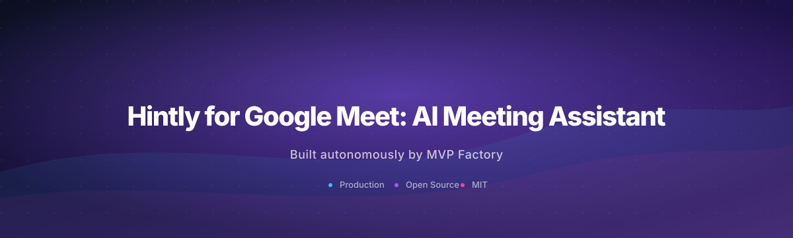
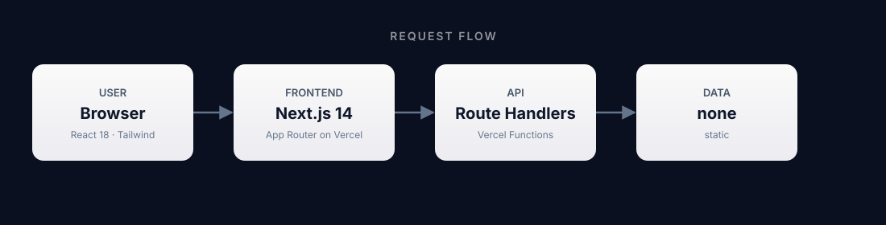

<div align="center">



# Hintly for Google Meet: AI Meeting Assistant

### AI-powered real-time hints and assistance tool for Google Meet meetings to improve communication and productivity

      

</div>

---

## What is this?

AI-powered real-time hints and assistance tool for Google Meet meetings to improve communication and productivity

This repository was generated end-to-end by **[MVP Factory](https://github.com/malikmuhammadsaadshafiq-dev)** — eight specialized AI agents that research a real-world demand signal, design the system, write the code, test it, and ship it to Vercel.

<br />

## Architecture

<div align="center">



</div>

| Layer | Technology | Where it runs |
|-------|------------|---------------|
| Frontend | Next.js 14 + Tailwind | Vercel Edge / CDN |
| Backend | Next.js Route Handlers (TypeScript) | Vercel Functions / Edge — each `route.ts` is a stateless handler |
| Storage | none | n/a |

Backend logic lives inside the same Next.js app as Route Handlers. They deploy as Vercel Functions and run server-side per request.

<br />

## Project structure

```
api/
  __init__.py
  auth_utils.py
  database.py
  index.py
  llm_client.py
  models.py
  requirements.txt
  routes/
  ... (1 more)
extension/
  content.js
  manifest.json
next.config.js
package.json
postcss.config.js
src/
  app/
  components/
tailwind.config.js
tsconfig.json
```

<br />

## API surface

**Next.js Route Handlers** (`src/app/**/route.ts`):

```
/api/demo/stream
```

<br />

## Environment variables

- `DATABASE_URL`
- `FRONTEND_ORIGIN`
- `GOOGLE_CLIENT_ID`
- `JWT_SECRET`
- `NVIDIA_API_KEY`
- `NVIDIA_BASE_URL`
- `NVIDIA_MODEL`

<br />

## Running locally

```bash
git clone https://github.com/Muhammad-Faizan-Tariq/hintly-for-google-meet-ai-d809
cd hintly-for-google-meet-ai-d809
npm install
npm run dev
```

Open <http://localhost:3000>. 

<br />

## Deploy

Pushes to `main` auto-deploy to Vercel. Manual deploy:

```bash
npm i -g vercel
vercel --prod
```

<br />

## For AI agents reading this repo

- **Stack:** Next.js 14 frontend + Next.js Route Handlers (TypeScript)
- **Run locally:** `npm install && npm run dev` (port 3000)
- **Backend lives at:** `src/app/api/`
- **Backend runs as:** Vercel Functions / Edge — each `route.ts` is a stateless handler
- **No long-running server processes** — every request hits a fresh function instance.
- **Storage:** none
- **Required env vars:** `DATABASE_URL`, `FRONTEND_ORIGIN`, `GOOGLE_CLIENT_ID`, `JWT_SECRET`, `NVIDIA_API_KEY`, `NVIDIA_BASE_URL`, `NVIDIA_MODEL`

<br />

## License

MIT — generated autonomously by [MVP Factory](https://github.com/malikmuhammadsaadshafiq-dev).
